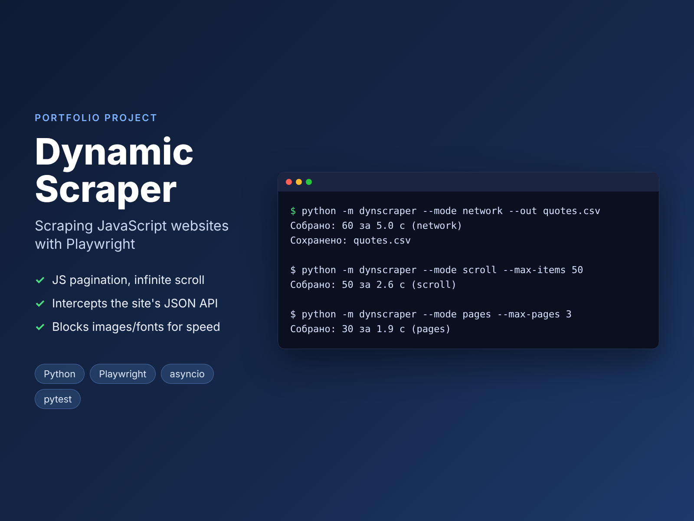

# Dynamic Scraper: scraping JavaScript websites with Playwright



A scraper for sites where content is rendered by JavaScript: plain `requests` + BeautifulSoup sees an empty page there. It uses a real headless browser (Playwright, Chromium) and shows three common approaches:

| Mode | When to use | How it works |
|---|---|---|
| `pages` | content is rendered by JS, there is a "Next" button | waits for elements, extracts them, clicks "Next" |
| `scroll` | infinite scroll | scrolls down until new elements stop appearing |
| `network` | the site loads data from its own API | **intercepts the JSON responses** instead of parsing HTML: faster and doesn't break when the layout changes |

The demo target is [quotes.toscrape.com](https://quotes.toscrape.com), a public sandbox for practicing scraping (`/js/` and `/scroll` versions).

> Portfolio project. The tests run against a local fake site (served through Playwright routing), so they don't depend on the network.

**Stack:** Python 3.11+ · Playwright (async) · pytest-asyncio · GitHub Actions

## Features

- Async Playwright with one browser context per run
- **Blocks images, fonts and media**, so pages load several times faster
- Reliable waits (`wait_for_selector`, `expect_navigation`) instead of fixed sleeps
- Detects the end of infinite scroll (N scroll rounds with no new items)
- De-duplicates items, supports item and page limits
- Saves a full-page screenshot `error.png` on failure for easy debugging
- Export to CSV (Excel-friendly) or JSON

## Usage

```bash
pip install -r requirements.txt
python -m playwright install chromium

python -m dynscraper --mode network --out quotes.csv
python -m dynscraper --mode pages --max-pages 3 --out quotes.json
python -m dynscraper --mode scroll --max-items 50 --show    # watch the browser window
```

Example output (the CLI prints in Russian):

```
Собрано: 100 за 4.2 с (scroll)
```

## Tests

```bash
pip install -r requirements-dev.txt
python -m playwright install chromium
pytest -q && ruff check .
```

`tests/fake_site.py` is a small fake site: a JS-rendered page with pagination, an infinite-scroll page and a JSON API. All three modes are tested against it, along with the limits and the export.

## Structure

```
dynscraper/
├── browser.py      # browser launch, resource blocking
├── strategies.py   # pages / scroll / network
├── models.py       # Quote
├── export.py       # CSV / JSON
└── __main__.py     # CLI
```
